# Langfuse Eval 实现分析

## 1. 概述

Langfuse 的 Eval 系统是一个基于 LLM-as-a-Judge 和代码评估器的自动化评估框架，用于对 LLM 应用的输出进行质量评估。该系统支持多种评估类型，包括 LLM-as-Judge、Code-based 和 Decision Model 评估器。

---

## 2. 核心架构

### 2.1 整体架构图

> **架构说明**：Langfuse Eval 系统采用分层架构设计，从上到下依次为：用户界面层（UI）、API 层、共享包层、Worker 层、队列层和存储层。各层通过明确的接口进行通信，实现关注点分离。

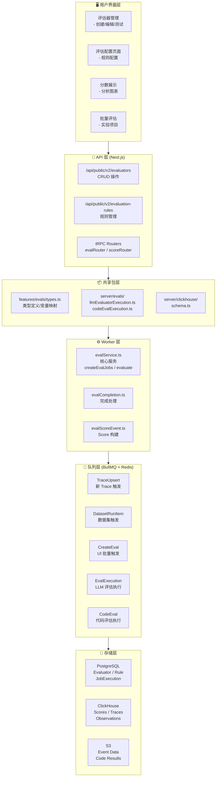

**关键设计要点**：
- **UI 层**：提供评估器管理和规则配置的用户界面
- **API 层**：RESTful 接口和 tRPC 路由处理外部请求
- **Worker 层**：核心业务逻辑，包括任务创建和评估执行
- **队列层**：使用 BullMQ 实现异步处理，支持多种触发源
- **存储层**：PostgreSQL 存储配置，ClickHouse 存储分析数据，S3 存储事件数据

---

### 2.2 数据模型

> **数据模型说明**：Eval 系统的核心数据模型围绕评估器（Evaluator）、评估规则（EvaluationRule）和执行记录（JobExecution）展开。EvaluatorVersion 支持评估器的版本管理，EvaluationRuleEvaluatorAssignment 实现规则与评估器的多对多关联。

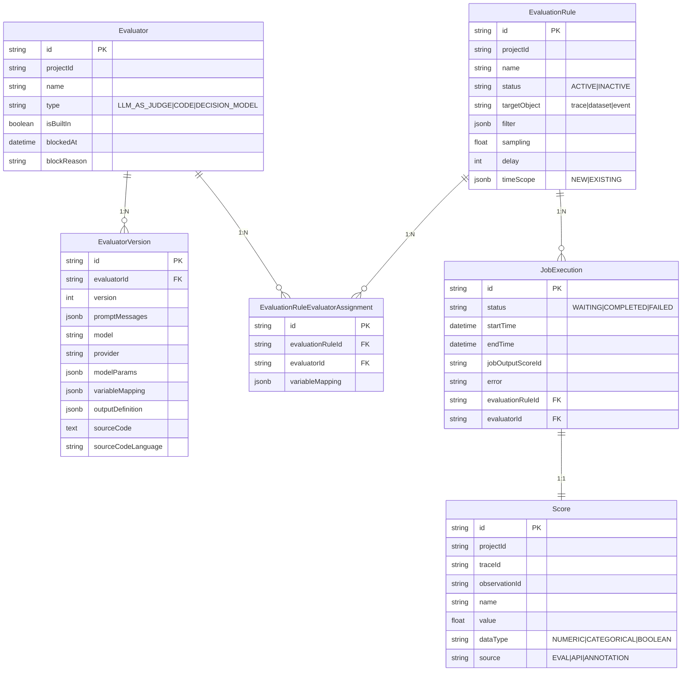

**模型关系说明**：
- **Evaluator → EvaluatorVersion**：一对多关系，支持评估器版本迭代
- **EvaluationRule → Evaluator**：通过 Assignment 表实现多对多关联
- **JobExecution**：记录每次评估执行的详细信息
- **Score**：评估结果持久化到 Score 表，与 Trace/Observation 关联

---

## 3. 评估器类型

### 3.1 评估器类型架构

> **评估器类型说明**：Langfuse 支持四种评估器类型：LLM_AS_JUDGE（使用 LLM 评估）、CODE（代码逻辑评估）、DECISION_MODEL（决策模型）和 FACET。每种类型有不同的执行机制和适用场景。

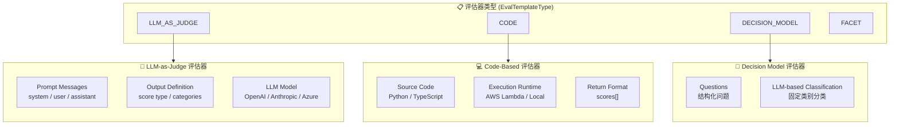

**各评估器特点对比**：

| 类型 | 输入 | 执行环境 | 输出格式 | 适用场景 |
|------|------|----------|----------|----------|
| LLM_AS_JUDGE | Prompt 模板 + 变量映射 | LLM API 调用 | {score, scoreExplanation} | 开放式评估，如回答质量、相关性 |
| CODE | 源代码 + 变量 | AWS Lambda / 本地沙箱 | scores[] 数组 | 确定性逻辑，如格式检查、长度验证 |
| DECISION_MODEL | 结构化问题 | LLM API | 分类结果 | 固定集合分类，如主题分类 |
| FACET | 多维度评估 | LLM API | 多维度分数 | 多维度综合评估 |

---

## 4. 核心流程

### 4.1 评估任务创建流程

> **流程说明**：评估任务创建是 Eval 系统的核心入口。当新 Trace 到达、数据集运行项创建或用户手动触发时，系统会执行以下流程：获取评估规则 → 过滤匹配 → 采样决策 → 创建执行记录 → 入队执行。

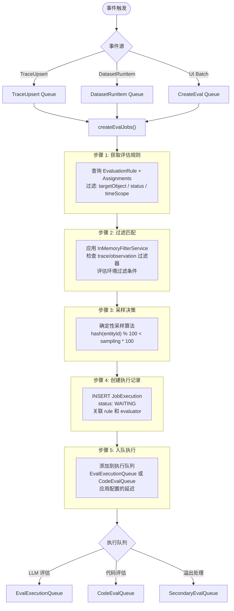

**关键实现细节**：
- **规则匹配**：使用 `InMemoryFilterService` 在内存中过滤 Trace/Observation
- **采样算法**：基于 entityId 的哈希值进行确定性采样，相同实体总是得到相同结果
- **延迟执行**：支持配置执行延迟，用于等待 Observation 数据完整

---

### 4.2 LLM-as-Judge 执行流程

> **流程说明**：LLM-as-Judge 是 Langfuse 最核心的评估方式。执行流程包括：加载执行上下文 → 提取变量 → 构建并调用 LLM → 处理输出 → 持久化 Score。

```mermaid
flowchart TD
    Start([EvalExecution Queue Job]) --> Load["evaluate() - evalService.ts"]

    subgraph Step1["1. 加载执行上下文"]
        L1["获取 JobExecution"]
        L2["获取 EvaluationRule + Assignment"]
        L3["获取 EvaluatorVersion"]
        L4["验证执行前置条件"]
    end

    subgraph Step2["2. 提取变量"]
        V1["加载 trace/observation 数据"]
        V2["应用 variableMapping:<br/>trace.input → {{traceInput}}<br/>trace.output → {{traceOutput}}<br/>observation.input → {{input}}<br/>observation.output → {{output}}"]
        V3["处理 JSON selectors<br/>如 $.messages[0].content"]
    end

    subgraph Step3["3. 执行 LLM 评估"]
        E1["构建 prompt messages<br/>变量插值到模板"]
        E2["调用 LLM API<br/>配置模型参数"]
        E3["解析结构化输出<br/>{ score, scoreExplanation }"]
    end

    subgraph Step4["4. 处理输出"]
        O1["验证 outputDefinition:<br/>NUMERIC: 检查 min/max<br/>CATEGORICAL: 验证类别<br/>BOOLEAN: 验证 true/false"]
        O2["构建 Score payload"]
        O3["生成执行 trace"]
    end

    subgraph Step5["5. 完成执行"]
        C1["buildEvalScoreWritePayloads()"]
        C2["上传 score 到 S3"]
        C3["入队 score ingestion"]
        C4["更新 JobExecution:<br/>status: COMPLETED<br/>jobOutputScoreId: score id"]
    end

    Load --> Step1 --> Step2 --> Step3 --> Step4 --> Step5

    Step5 --> Persistence["Score 持久化"]
    Persistence --> S3["S3 存储"] --> IngestionQ["Ingestion Queue"] --> ClickHouse["ClickHouse scores 表"]
```

**变量映射示例**：
```
变量映射配置:
{
  "templateVariable": "input",        // Prompt 中的变量名
  "langfuseObject": "generation",     // 提取对象类型
  "objectName": "OpenAI Call",        // 具体 observation 名称
  "selectedColumnId": "output",       // 提取字段
  "jsonSelector": "$.choices[0]"      // JSON 路径选择器
}
```

---

### 4.3 Code-Based 评估执行流程

> **流程说明**：代码评估器使用用户编写的 Python 或 TypeScript 代码执行评估。代码在隔离的沙箱环境中执行（生产环境使用 AWS Lambda，开发环境使用本地沙箱）。

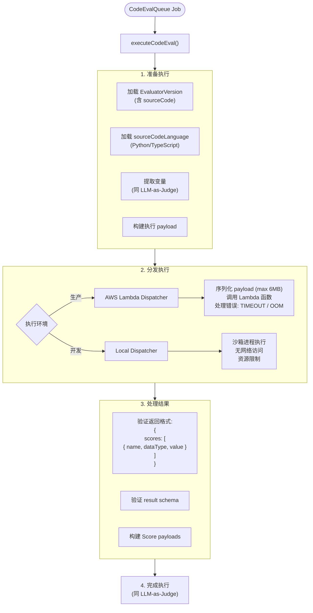

**代码评估器返回格式**：
```typescript
{
  scores: [
    {
      name: "score_name",
      dataType: "NUMERIC" | "CATEGORICAL" | "BOOLEAN",
      value: 0.85 | "category" | true
    }
  ]
}
```

**错误码说明**：
| 错误码 | 说明 |
|--------|------|
| TIMEOUT | 执行超时 |
| OUT_OF_MEMORY | 内存超限 |
| INVALID_RESULT | 返回格式无效 |
| SOURCE_TOO_LARGE | 源代码过大 |
| PAYLOAD_TOO_LARGE | 输入数据过大 |

---

## 5. 评估目标对象

### 5.1 目标对象类型

> **目标对象说明**：Langfuse 支持三种主要评估目标：TRACE（评估整个追踪）、DATASET（评估数据集项目）和 EVENT/EXPERIMENT（评估单个事件或批量实验）。

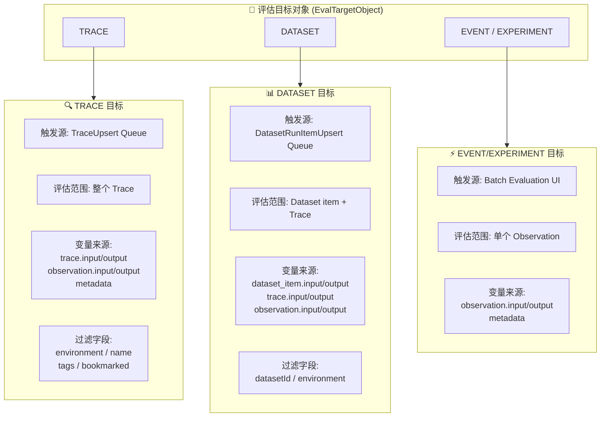

**目标对象对比**：
| 目标 | 触发方式 | 评估范围 | 典型用途 |
|------|----------|----------|----------|
| TRACE | 自动（新 Trace 到达） | 整个追踪树 | 端到端质量评估 |
| DATASET | 自动（数据集运行） | 数据集项 + 关联追踪 | 基准测试、回归测试 |
| EVENT | 手动（UI 触发） | 单个 Observation | 特定步骤评估 |
| EXPERIMENT | 批量 UI | 多个 Observations | 批量评估实验结果 |

---

## 6. 变量映射系统

### 6.1 变量映射架构

> **变量映射说明**：变量映射系统负责从 Trace/Observation 中提取数据并注入到评估器的 Prompt 模板中。支持多种 Langfuse 对象和灵活的 JSON 路径选择。

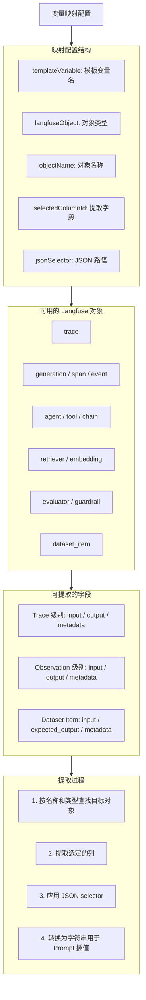

**JSON Selector 示例**：
- `$.choices[0].message.content` - 提取 OpenAI 响应内容
- `$.messages[0].content` - 提取第一条消息内容
- `$.tool_calls[0].function.name` - 提取工具调用名称

---

## 7. 过滤与采样

### 7.1 评估规则过滤

> **过滤机制说明**：评估规则支持基于 Trace 和 Observation 属性的过滤条件。过滤在内存中执行（InMemoryFilterService），支持多种操作符。

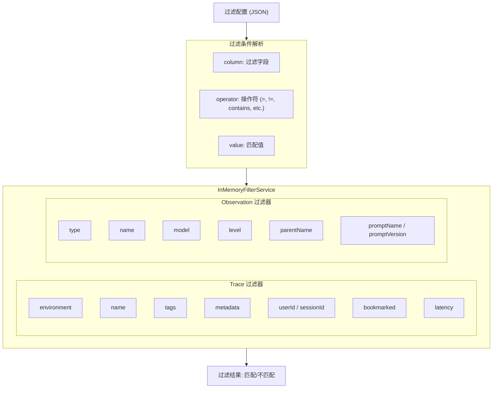

### 7.2 采样算法

> **采样说明**：Langfuse 使用确定性哈希采样算法，相同实体总是得到相同的采样结果，无需跨 Worker 协调。

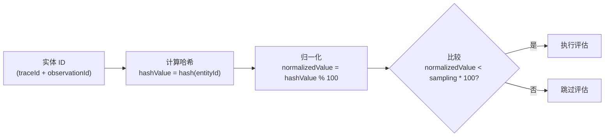

**采样示例**：
- 采样率 = 0.3 (30%)
- traceId = "abc123"
- hash("abc123") % 100 = 25
- 25 < 30 → 执行评估 ✓

**采样优势**：
- **确定性**：相同 Trace 总是得到相同采样结果
- **无协调**：不同 Worker 独立决策，结果一致
- **均匀分布**：哈希确保均匀分布

---

## 8. 错误处理与重试

### 8.1 错误处理流程

> **错误处理说明**：Eval 系统将错误分为三类：可重试错误、不可恢复错误和特殊处理错误。LLM 错误通过分类函数进行精细化处理。

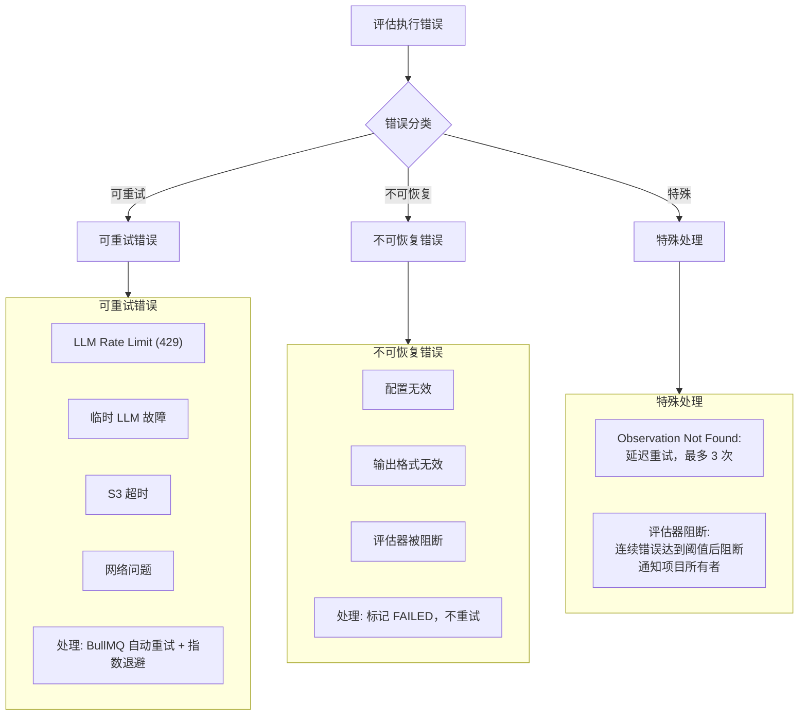

### 8.2 LLM 错误分类

> **LLM 错误分类说明**：`classifyEvaluatorLlmError()` 函数将 LLM 错误分为多个类别，每个类别有不同的处理策略。

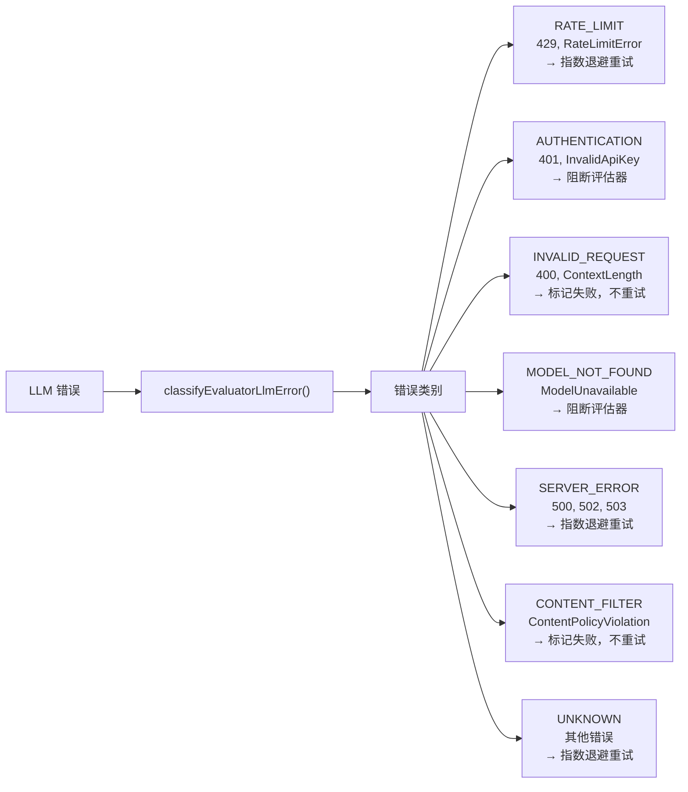

**评估器阻断机制**：
- 追踪连续错误次数
- 达到阈值后自动阻断评估器
- 设置 `blockedAt` 和 `blockReason`
- 通知项目所有者

---

## 9. 关键文件索引

### 9.1 核心实现文件

| 组件 | 文件路径 | 描述 |
|------|----------|------|
| **评估服务** | `worker/src/features/evaluation/evalService.ts` | 核心评估逻辑，包括创建和执行 |
| **LLM执行** | `packages/shared/src/server/evals/llmEvaluatorExecution.ts` | LLM-as-Judge 执行 |
| **代码执行** | `packages/shared/src/server/evals/codeEvalExecution.ts` | Code-based 评估执行 |
| **评估队列** | `worker/src/queues/evalQueue.ts` | BullMQ 队列处理器 |
| **类型定义** | `packages/shared/src/features/evals/types.ts` | 核心类型和枚举 |
| **输出定义** | `packages/shared/src/features/evals/outputDefinition.ts` | 输出格式验证 |
| **完成处理** | `worker/src/features/evaluation/evalCompletion.ts` | 评估完成后处理 |
| **变量提取** | `packages/shared/src/server/evals/extractObservationVariables.ts` | 变量提取逻辑 |

### 9.2 数据模型文件

| 模型 | Schema位置 | 描述 |
|------|----------|------|
| `Evaluator` | `schema.prisma` | 评估器定义 |
| `EvaluatorVersion` | `schema.prisma` | 评估器版本 |
| `EvaluationRule` | `schema.prisma` | 评估规则 |
| `JobExecution` | `schema.prisma` | 执行记录 |
| `ScoreConfig` | `schema.prisma` | 分数配置 |

### 9.3 UI组件

| 组件 | 路径 | 描述 |
|------|------|------|
| 评估器管理 | `web/src/features/evals/v2/` | V2评估器界面 |
| 评估配置 | `web/src/features/evals/pages/` | 配置页面 |
| 分数显示 | `web/src/features/scores/` | 分数展示组件 |

---

## 10. 配置选项

### 10.1 评估规则配置

```typescript
{
  // 基本配置
  name: string,                    // 规则名称
  status: "ACTIVE" | "INACTIVE",   // 规则状态
  targetObject: "trace" | "dataset" | "event" | "experiment",  // 评估目标
  
  // 触发条件
  filter: FilterCondition[],       // 过滤条件
  sampling: number,                // 采样率 (0-1)
  delay: number,                   // 延迟执行 (ms)
  timeScope: ("NEW" | "EXISTING")[],  // 时间范围
  
  // 关联
  assignments: EvaluationRuleEvaluatorAssignment[]  // 评估器分配
}
```

### 10.2 环境变量

| 变量 | 描述 | 默认值 |
|------|------|--------|
| `LANGFUSE_EVAL_EXECUTION_CONCURRENCY` | 并发执行数 | 10 |
| `LANGFUSE_SECONDARY_EVAL_EXECUTION_QUEUE_ENABLED_PROJECT_IDS` | 二级队列项目 | - |
| `LANGFUSE_CODE_EVAL_LAMBDA_FUNCTION` | Lambda函数名 | - |

---

## 11. 监控与指标

> **监控指标说明**：Eval 系统提供完整的监控指标，涵盖执行、队列、LLM 调用和 Score 持久化。

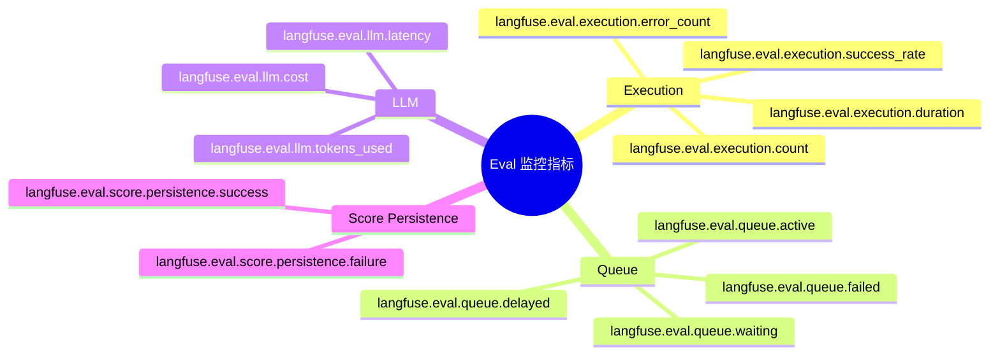

---

## 附录：完整评估执行时序图

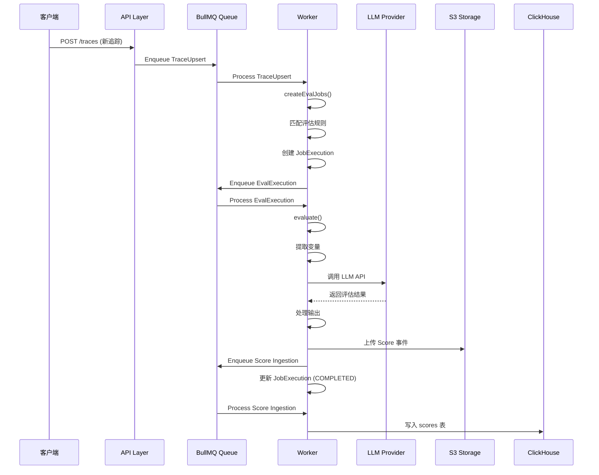
