# Langfuse Observability 实现分析

## 1. 概述

Langfuse 的 Observability（可观测性）系统是一个专为 LLM 应用设计的追踪和监控系统，支持 OpenTelemetry 协议，提供 Trace、Observation、Score 等核心概念来记录和分析 LLM 应用的执行过程。

---

## 2. 核心概念

### 2.1 数据模型层次

> **数据模型说明**：Langfuse Observability 系统的数据模型采用三层结构：Trace（追踪）→ Observation（观察）→ Score（评分）。Trace 代表一次完整的用户交互，Observation 记录其中的各个步骤，Score 用于对结果进行量化评估。

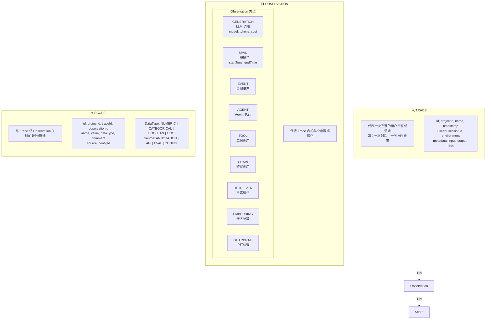

**核心概念解释**：
- **Trace**：最高级别的抽象，代表一次完整的请求或对话流程
- **Observation**：Trace 内部的原子操作，支持多种类型以适应不同场景
- **Score**：可附加到 Trace 或 Observation 上的量化评估结果

### 2.2 Observation 层级关系

> **层级关系说明**：Observation 通过 `parentObservationId` 字段构建父子关系，形成树状结构。顶层 Observation 的 `parentObservationId` 为 null，表示直接属于 Trace。

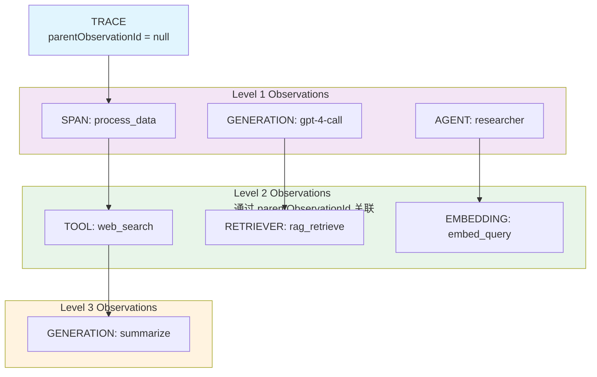

### 2.3 Observation 字段详解

> **字段说明**：Observation 包含通用字段和 GENERATION 特有字段。通用字段适用于所有类型，GENERATION 特有字段用于记录 LLM 调用的详细信息。

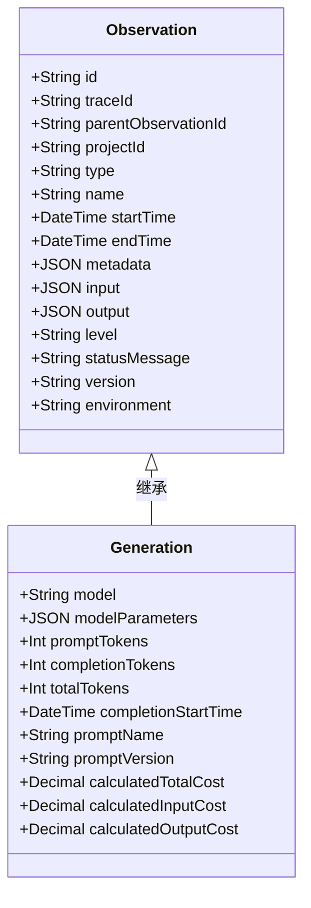

**Level 枚举值**：
| Level | 说明 |
|-------|------|
| DEFAULT | 默认级别 |
| DEBUG | 调试信息 |
| WARNING | 警告 |
| ERROR | 错误 |

---

## 3. 系统架构

### 3.1 整体架构图

> **架构说明**：Langfuse Observability 系统采用典型的分层架构，从客户端 SDK 到存储层共五层。数据从客户端流入，经过 API 层验证，通过队列异步处理，最终持久化到 ClickHouse。

```mermaid
graph TB
    subgraph Client["🔗 客户端 SDK"]
        direction LR
        PythonSDK["Python SDK<br/>@langfuse"]
        JSSDK["JS/TS SDK<br/>langfuse"]
        OTel["OpenTelemetry<br/>OTLP Exporter"]
        REST["REST API<br/>POST /ingest"]
        Langchain["Langchain<br/>Integration"]
    end

    subgraph API["🌐 Web API Layer (Next.js)"]
        IngestAPI["/api/public/ingestion<br/>POST - 批量摄入<br/>认证: API Key"]
        OTelAPI["/api/public/otel/v1/traces<br/>OpenTelemetry OTLP<br/>Protobuf / JSON"]
        CRUDAPI["/api/public/traces<br/>/api/public/observations<br/>/api/public/scores<br/>GET / POST / PATCH / DELETE"]
    end

    subgraph Shared["📦 Shared Package Layer"]
        ProcessBatch["processEventBatch.ts<br/>- 验证事件 schema<br/>- 写入 S3<br/>- 入队 IngestionQueue"]
        EventTypes["types.ts<br/>- 事件类型定义<br/>- Schema 验证 (Zod)"]
        CHSchema["clickhouse/schema.ts<br/>- CH 表定义<br/>- 实体类型映射"]
    end

    subgraph Queue["📨 Queue Layer (BullMQ + Redis)"]
        IngestionQ["IngestionQueue<br/>处理原始事件<br/>写入 ClickHouse"]
        TraceUpsertQ["TraceUpsertQueue<br/>触发下游处理<br/>创建评估任务"]
        SecondaryQ["SecondaryIngestionQueue<br/>处理 S3 限流<br/>负载均衡"]
        OTelQ["OtelIngestionQueue<br/>OTLP 处理<br/>格式转换"]
        TraceBatchQ["TraceBatchQueue<br/>批量 Trace 写入"]
    end

    subgraph Worker["⚙️ Worker Layer"]
        IngestionService["IngestionService<br/>- mergeAndWrite()<br/>- processTraceEvent()<br/>- processObservationEvent()<br/>- processScoreEvent()"]
        CHWriter["ClickhouseWriter<br/>- 批量写入<br/>- 连接池<br/>- 错误重试"]
    end

    subgraph Storage["💾 Storage Layer"]
        PostgreSQL["PostgreSQL<br/>配置和元数据<br/>Trace / TraceSession<br/>ScoreConfig"]
        ClickHouse["ClickHouse<br/>高容量分析数据<br/>traces / observations<br/>scores / dataset_run_items"]
        S3["S3<br/>大对象存储<br/>事件数据 / 媒体文件"]
    end

    Client --> API
    API --> Shared
    Shared --> Queue
    Queue --> Worker
    Worker --> Storage
```

**各层职责**：
| 层 | 职责 | 技术栈 |
|----|------|--------|
| Client | 数据采集和发送 | Python/JS SDK, OTLP |
| API | 请求验证和路由 | Next.js, tRPC |
| Shared | 共享业务逻辑 | TypeScript, Zod |
| Queue | 异步任务处理 | BullMQ, Redis |
| Worker | 数据转换和写入 | Node.js |
| Storage | 持久化存储 | PostgreSQL, ClickHouse, S3 |

---

## 4. 数据摄入流程

### 4.1 Ingestion 流程

> **流程说明**：数据摄入是 Observability 系统的核心流程。事件从客户端到达后，经过验证、S3 存储、队列处理，最终写入 ClickHouse。整个流程采用异步设计，支持高并发和容错。

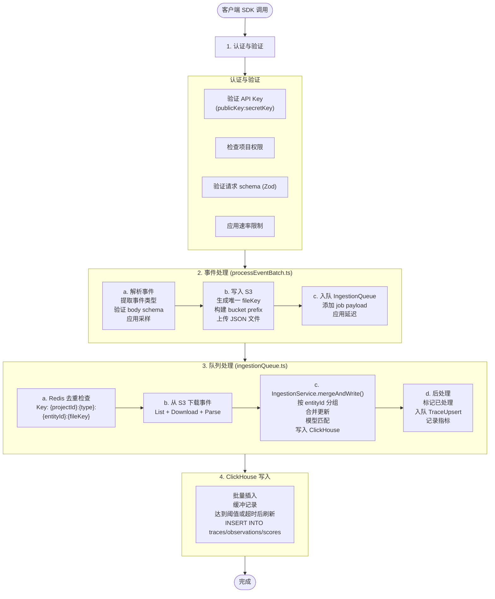

**关键设计要点**：
- **S3 缓冲**：事件先写入 S3，再异步处理，解耦 API 响应和数据处理
- **去重机制**：Redis 缓存防止重复处理
- **批量写入**：ClickHouse 使用批量插入提高写入性能
- **延迟处理**：UTC 日期边界附近添加延迟，避免日期重复

---

### 4.2 OpenTelemetry 摄入流程

> **OTLP 流程说明**：Langfuse 支持标准的 OpenTelemetry 协议，可以将 OTLP 格式的数据转换为 Langfuse 格式并存储。支持 Protobuf 和 JSON 两种编码格式。

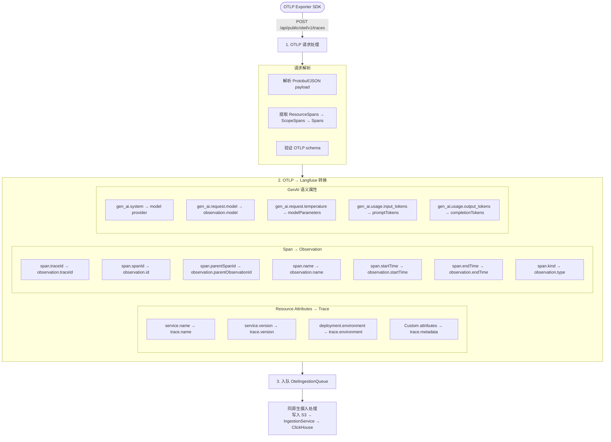

**Span Kind 映射**：
| OTel Span Kind | Langfuse Observation Type |
|----------------|---------------------------|
| CLIENT / SERVER (含 LLM 属性) | GENERATION |
| INTERNAL | SPAN |
| PRODUCER / CONSUMER | EVENT |

---

## 5. 查询架构

### 5.1 数据查询流程

> **查询说明**：Langfuse 使用 ClickHouse 作为主要分析数据库，支持高性能的时间序列查询。查询优化包括分区裁剪、索引优化和物化视图。

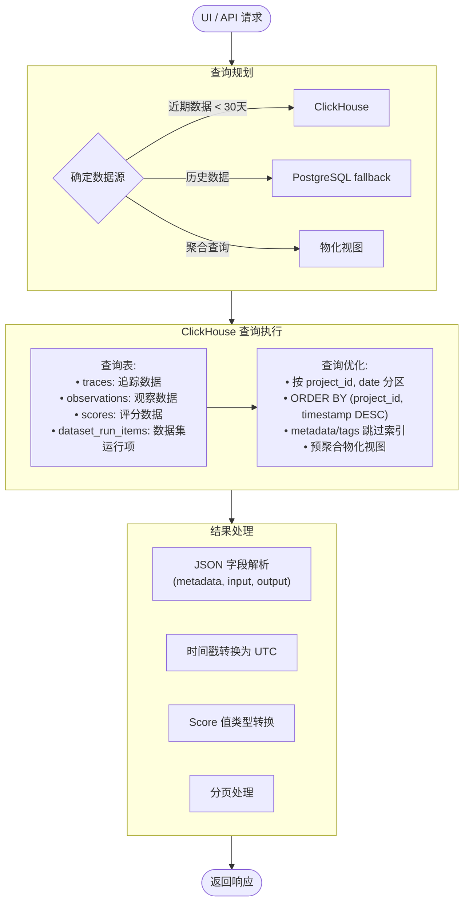

### 5.2 ClickHouse Schema

> **Schema 设计说明**：ClickHouse 表使用 ReplacingMergeTree 引擎，支持最终一致性。按月份分区，按 (project_id, timestamp DESC, id) 排序，优化时间序列查询。

```mermaid
erDiagram
    TRACES {
        string id
        datetime timestamp
        string name
        string project_id
        string user_id
        string session_id
        string environment
        json metadata
        string input
        string output
        array tags
        boolean bookmarked
        boolean public
        datetime event_ts
        uint8 is_deleted
    }

    OBSERVATIONS {
        string id
        string trace_id
        string project_id
        string type
        string parent_observation_id
        datetime start_time
        datetime end_time
        string name
        json metadata
        string level
        string input
        string output
        string model
        string model_parameters
        uint64 prompt_tokens
        uint64 completion_tokens
        uint64 total_tokens
        datetime completion_start_time
        decimal calculated_total_cost
        decimal calculated_input_cost
        decimal calculated_output_cost
        datetime event_ts
        uint8 is_deleted
    }

    SCORES {
        string id
        string project_id
        string trace_id
        string observation_id
        datetime timestamp
        string name
        float64 value
        string string_value
        string data_type
        string comment
        string source
        string config_id
        datetime event_ts
        uint8 is_deleted
    }

    TRACES ||--o{ OBSERVATIONS : "1:N"
    TRACES ||--o{ SCORES : "1:N"
    OBSERVATIONS ||--o{ SCORES : "1:N"
```

**表引擎配置**：
```sql
ENGINE = ReplacingMergeTree(event_ts, is_deleted)
PARTITION BY toYYYYMM(timestamp)
ORDER BY (project_id, timestamp DESC, id)
SETTINGS index_granularity = 8192;
```

---

## 6. 事件类型

### 6.1 Ingestion Event Types

> **事件类型说明**：Langfuse 定义了多种事件类型，按实体分为 Trace 事件、Observation 事件、Score 事件和 Dataset 事件。每种事件都有 create 和 update 两种操作。

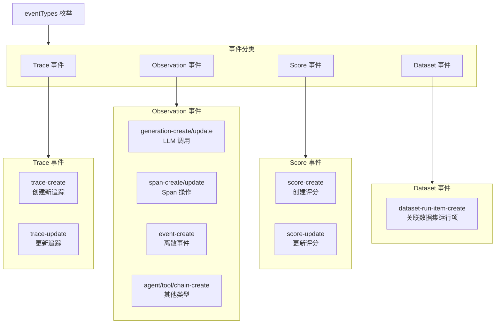

**事件处理顺序**：
1. 非 update 事件优先处理
2. update 事件按时间戳排序
3. 相同 entityId 的事件合并处理

---

## 7. 成本计算

### 7.1 Model Matching & Cost Calculation

> **成本计算说明**：GENERATION 类型的 Observation 支持自动成本计算。系统根据模型名称查找定价信息，结合 token 使用量计算输入/输出成本。

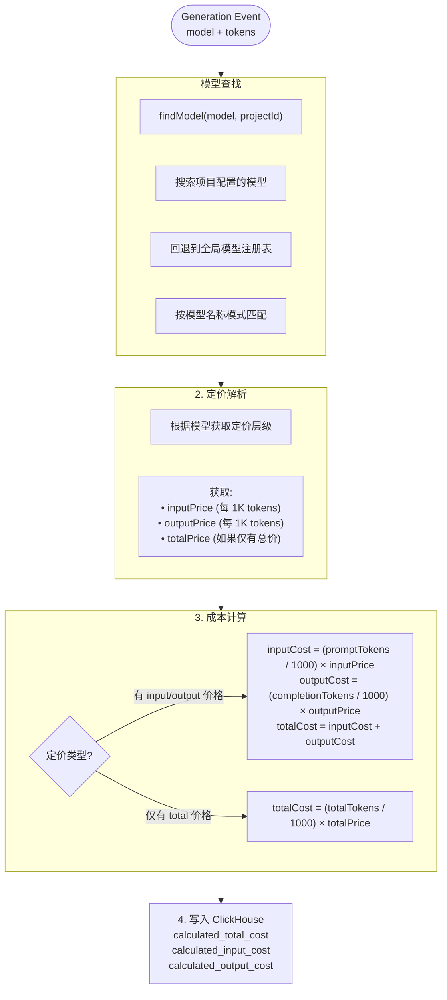

**Token 计算策略**：
| 模型类型 | Tokenizer |
|----------|-----------|
| OpenAI 模型 | tiktoken |
| 其他已知模型 | 模型特定 tokenizer |
| 未知模型 | 字符估算 |

---

## 8. Trace 处理与评估触发

### 8.1 Trace Upsert 流程

> **Trace Upsert 说明**：当 Trace 数据写入完成后，系统会触发 TraceUpsert 事件，用于启动下游处理流程，包括评估任务创建和自动化操作。

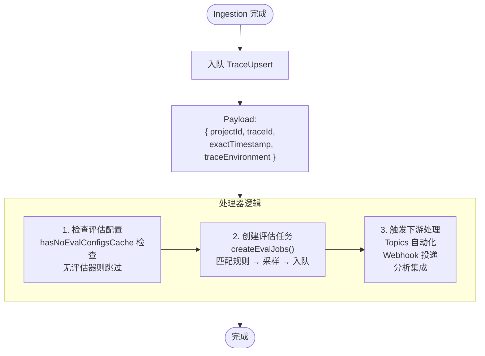

---

## 9. 关键组件索引

### 9.1 Web API 层

| 组件 | 路径 | 描述 |
|------|------|------|
| Ingestion API | `web/src/pages/api/public/ingestion.ts` | 批量摄入端点 |
| OTLP Endpoint | `web/src/pages/api/public/otel/` | OpenTelemetry 接收 |
| Traces API | `web/src/pages/api/public/traces/` | Trace CRUD |
| Observations API | `web/src/pages/api/public/v2/observations/` | Observation API |
| Scores API | `web/src/pages/api/public/scores/` | Score API |

### 9.2 Worker 层

| 组件 | 路径 | 描述 |
|------|------|------|
| Ingestion Queue | `worker/src/queues/ingestionQueue.ts` | 摄入队列处理 |
| OTel Queue | `worker/src/queues/otelIngestionQueue.ts` | OTLP 处理 |
| Trace Batch Queue | `worker/src/queues/traceBatchQueue.ts` | 批量写入 |
| IngestionService | `worker/src/services/IngestionService/index.ts` | 核心摄入逻辑 |
| ClickhouseWriter | `worker/src/services/ClickhouseWriter/` | ClickHouse 写入 |

### 9.3 Shared 层

| 组件 | 路径 | 描述 |
|------|------|------|
| Event Types | `packages/shared/src/server/ingestion/types.ts` | 事件类型定义 |
| Process Batch | `packages/shared/src/server/ingestion/processEventBatch.ts` | 批量处理 |
| Model Match | `packages/shared/src/server/ingestion/modelMatch.ts` | 模型匹配 |
| CH Schema | `packages/shared/src/server/clickhouse/schema.ts` | CH 表定义 |
| Queue Types | `packages/shared/src/server/queues.ts` | 队列类型 |

### 9.4 UI 层

| 组件 | 路径 | 描述 |
|------|------|------|
| Traces Page | `web/src/features/traces/` | Trace 列表和详情 |
| Trace Table | `web/src/features/traces/TracesTable.tsx` | Trace 表格组件 |
| Trace Review | `web/src/features/traces/TracePage.tsx` | Trace 审阅页 |
| Observations | `web/src/features/tracing-tables/observations/` | Observation 展示 |
| Scores | `web/src/features/scores/` | Score 相关组件 |

---

## 10. 性能优化

### 10.1 写入优化

> **写入优化说明**：Langfuse 采用多种策略优化写入性能，包括 S3 批量上传、Redis 去重、ClickHouse 批量写入和队列分区。

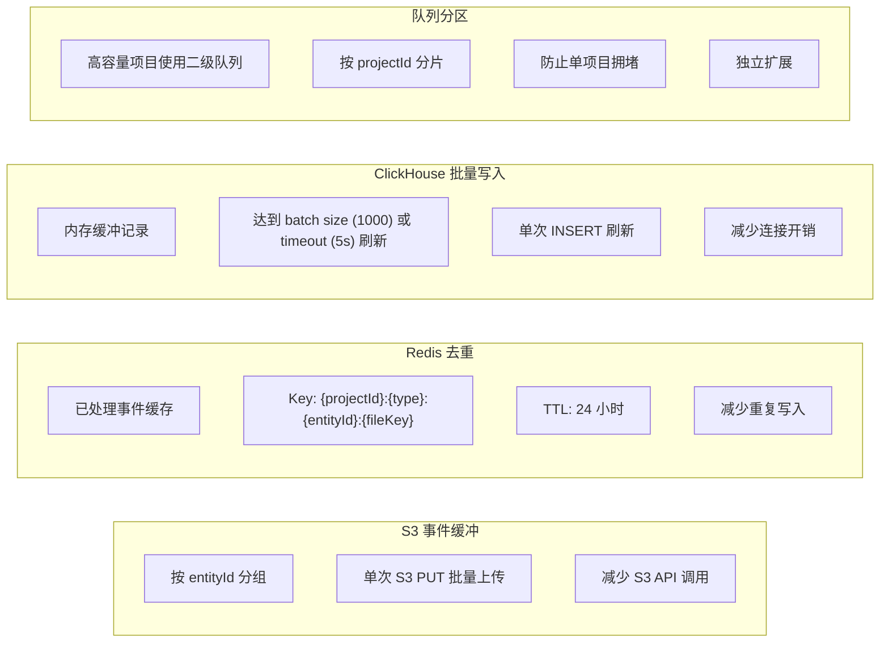

### 10.2 查询优化

> **查询优化说明**：ClickHouse 查询通过分区裁剪、排序索引、物化视图和缓存机制进行优化。

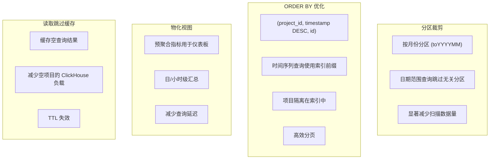

---

## 11. 监控与指标

> **监控指标说明**：Observability 系统提供完整的监控指标，涵盖摄入、队列、ClickHouse 和缓存。

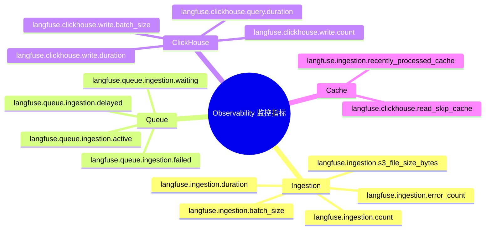

---

## 12. 环境变量配置

| 变量 | 描述 | 默认值 |
|------|------|--------|
| `DATABASE_URL` | PostgreSQL 连接 | - |
| `CLICKHOUSE_URL` | ClickHouse 连接 | - |
| `LANGFUSE_S3_EVENT_UPLOAD_BUCKET` | S3 事件存储桶 | - |
| `LANGFUSE_REDIS_CONNECTION_STRING` | Redis 连接 | - |
| `LANGFUSE_INGESTION_QUEUE_DELAY_MS` | 摄入队列延迟 | 5000 |
| `LANGFUSE_ENABLE_REDIS_SEEN_EVENT_CACHE` | 启用去重缓存 | true |
| `LANGFUSE_SECONDARY_INGESTION_QUEUE_ENABLED_PROJECT_IDS` | 二级队列项目 | - |
| `LANGFUSE_S3_EVENT_KEY_MAX_SEGMENT_BYTES` | S3 key 最大段大小 | - |

---

## 附录：完整数据摄入时序图

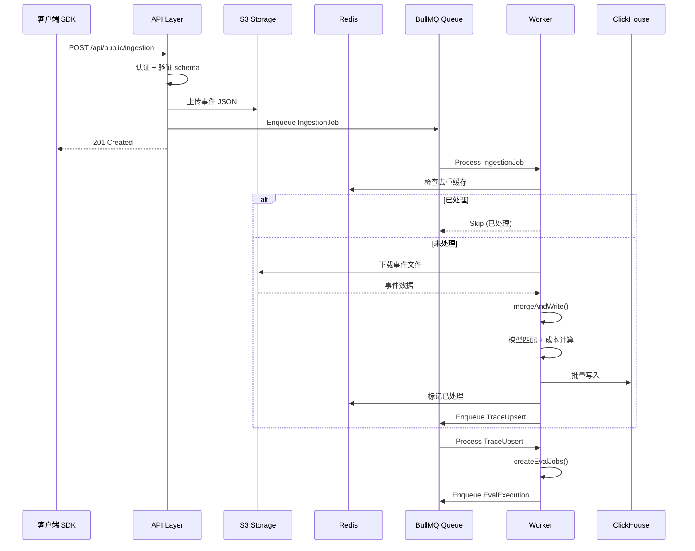
