# Ragas 评估框架深度分析

## 目录

- [1. 概述](#1-概述)
- [2. 核心架构](#2-核心架构)
  - [2.1 系统整体架构](#21-系统整体架构)
  - [2.2 评估流程](#22-评估流程)
- [3. 数据模型](#3-数据模型)
  - [3.1 样本类型](#31-样本类型)
  - [3.2 消息类型关系](#32-消息类型关系)
- [4. RAG 评估](#4-rag-评估)
  - [4.1 RAG 评估原理](#41-rag-评估原理)
  - [4.2 RAG 评估流程详解](#42-rag-评估流程详解)
- [5. RAG 评估指标详解](#5-rag-评估指标详解)
  - [5.1 Faithfulness（忠实度）](#51-faithfulness忠实度)
  - [5.2 Answer Relevancy（答案相关性）](#52-answer-relevancy答案相关性)
  - [5.3 Context Precision（上下文精度）](#53-context-precision上下文精度)
  - [5.4 Context Recall（上下文召回）](#54-context-recall上下文召回)
  - [5.5 Answer Correctness（答案正确性）](#55-answer-correctness答案正确性)
  - [5.6 Factual Correctness（事实正确性）](#56-factual-correctness事实正确性)
  - [5.7 Context Entities Recall（上下文实体召回）](#57-context-entities-recall上下文实体召回)
  - [5.8 Noise Sensitivity（噪声敏感度）](#58-noise-sensitivity噪声敏感度)
- [6. Agent 评估](#6-agent-评估)
  - [6.1 Agent 评估原理](#61-agent-评估原理)
  - [6.2 Agent 评估流程](#62-agent-评估流程)
- [7. Agent 评估指标详解](#7-agent-评估指标详解)
  - [7.1 Tool Call Accuracy（工具调用准确度）](#71-tool-call-accuracy工具调用准确度)
  - [7.2 Agent Goal Accuracy（目标达成度）](#72-agent-goal-accuracy目标达成度)
  - [7.3 Topic Adherence Score（主题遵循度）](#73-topic-adherence-score主题遵循度)
- [8. Workflow 评估](#8-workflow-评估)
  - [8.1 Workflow 评估原理](#81-workflow-评估原理)
  - [8.2 Workflow 评估适用指标](#82-workflow-评估适用指标)
- [9. 其他重要指标](#9-其他重要指标)
  - [9.1 Aspect Critic（方面评判）](#91-aspect-critic方面评判)
  - [9.2 Summarization Score（摘要质量评分）](#92-summarization-score摘要质量评分)
  - [9.3 非 LLM 指标](#93-非-llm-指标)
- [10. 指标选择指南](#10-指标选择指南)
  - [10.1 RAG 场景指标选择](#101-rag-场景指标选择)
  - [10.2 Agent 场景指标选择](#102-agent-场景指标选择)
  - [10.3 指标依赖关系](#103-指标依赖关系)
- [11. 关键组件索引](#11-关键组件索引)
  - [11.1 核心文件](#111-核心文件)
  - [11.2 RAG 指标](#112-rag-指标)
  - [11.3 Agent 指标](#113-agent-指标)
  - [11.4 通用指标](#114-通用指标)
- [12. 使用示例](#12-使用示例)
  - [12.1 RAG 评估示例](#121-rag-评估示例)
  - [12.2 Agent 评估示例](#122-agent-评估示例)
- [附录：完整指标速查表](#附录完整指标速查表)

---

## 1. 概述

**Ragas** 是一个专为 LLM 应用设计的评估框架，提供客观的评估指标、智能测试数据生成和数据驱动的分析能力。它支持三种主要评估场景：

- **RAG 评估**：评估检索增强生成系统的检索质量和生成质量
- **Agent 评估**：评估 AI Agent 的工具调用准确性和目标达成能力
- **Workflow 评估**：评估复杂工作流的端到端执行效果

---

## 2. 核心架构

### 2.1 系统整体架构

> **架构说明**：Ragas 采用模块化设计，由 Metrics 层、LLM/Embeddings 层、Prompt 层和 Evaluation 层组成。Metrics 定义了评估逻辑，LLM/Embeddings 提供推理能力，Evaluation 层负责协调整个评估流程。

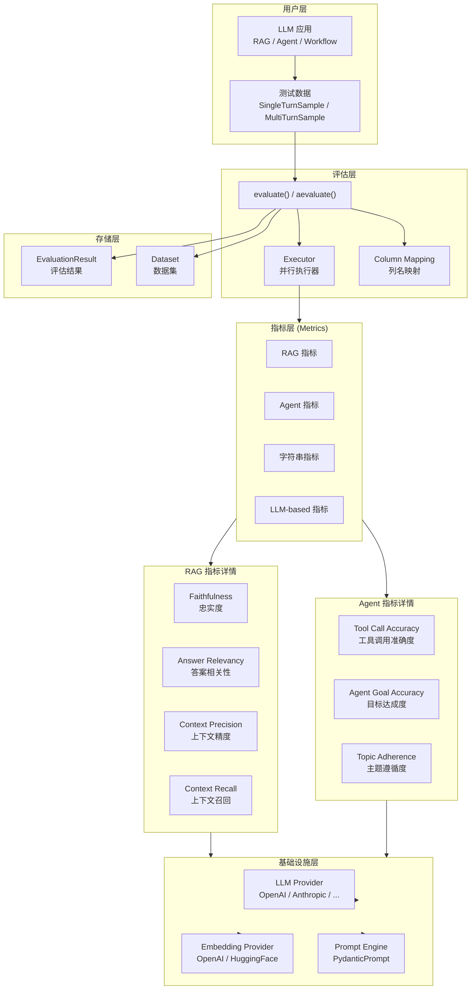

### 2.2 评估流程

> **流程说明**：评估从数据集开始，经过验证、初始化、并行执行，最终输出评估结果。每个样本独立评估，支持异步并行处理。

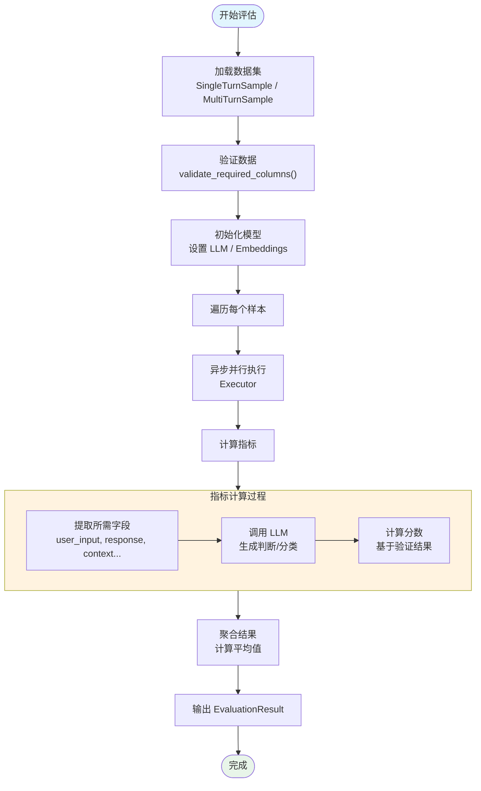

---

## 3. 数据模型

### 3.1 样本类型

> **样本模型说明**：Ragas 支持两种样本类型：SingleTurnSample（单轮交互）用于 RAG 评估，MultiTurnSample（多轮对话）用于 Agent/Workflow 评估。

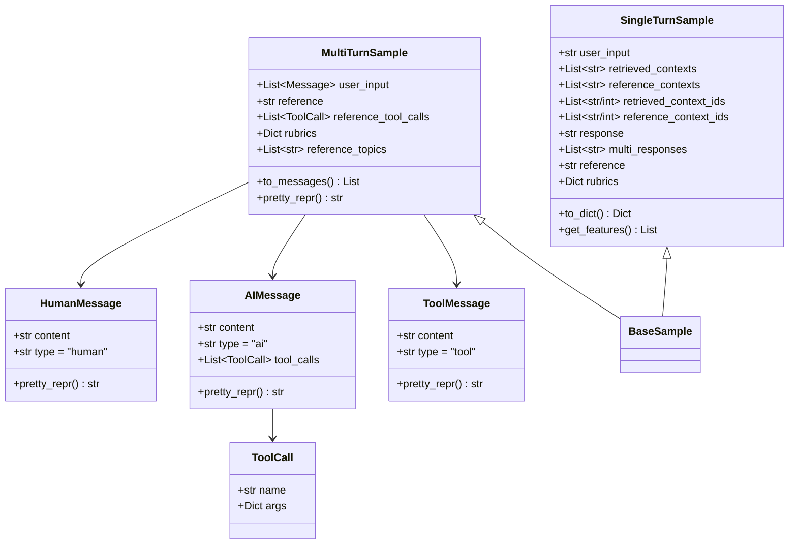

**字段说明**：

| 字段 | 类型 | 说明 |
|------|------|------|
| `user_input` | str / List[Message] | 用户输入的问题或对话 |
| `retrieved_contexts` | List[str] | 系统检索到的上下文 |
| `reference_contexts` | List[str] | 参考上下文（ground truth） |
| `response` | str | 系统生成的回答 |
| `reference` | str | 参考回答（ground truth） |
| `reference_tool_calls` | List[ToolCall] | 期望的工具调用序列 |
| `reference_topics` | List[str] | 期望讨论的主题列表 |

### 3.2 消息类型关系

> **消息关系说明**：MultiTurnSample 中的对话由 HumanMessage、AIMessage 和 ToolMessage 组成，模拟真实的 Agent 交互流程。

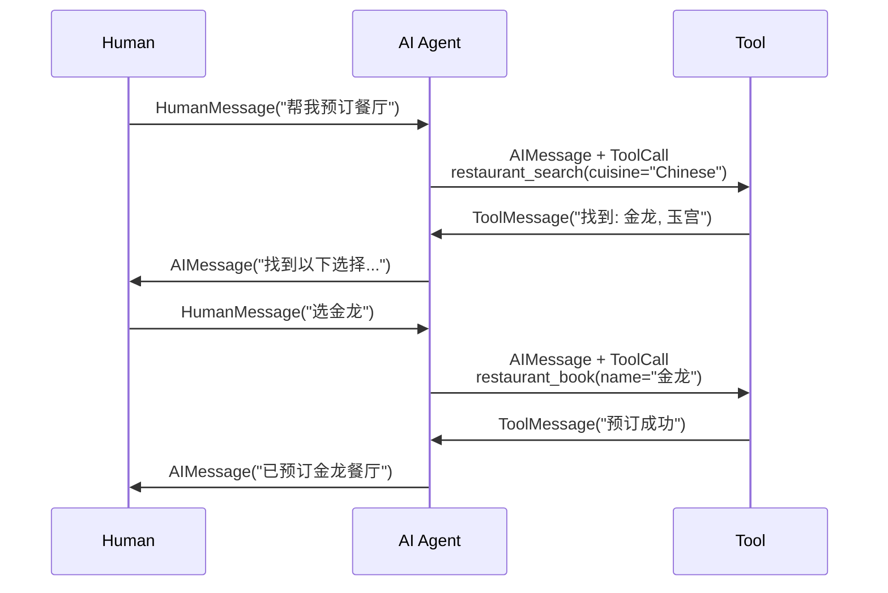

---

## 4. RAG 评估

### 4.1 RAG 评估原理

> **RAG 原理说明**：RAG（Retrieval-Augmented Generation）系统通过先检索相关上下文，再生成回答。评估需要同时考察**检索质量**和**生成质量**两个维度。

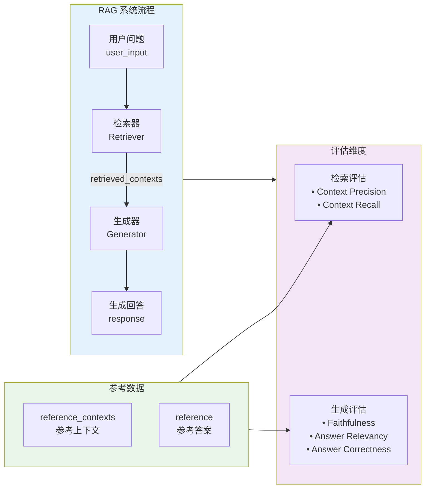

### 4.2 RAG 评估流程详解

> **评估流程说明**：RAG 评估从收集用户输入、检索上下文、生成回答开始，然后使用多个指标从不同角度评估系统质量。

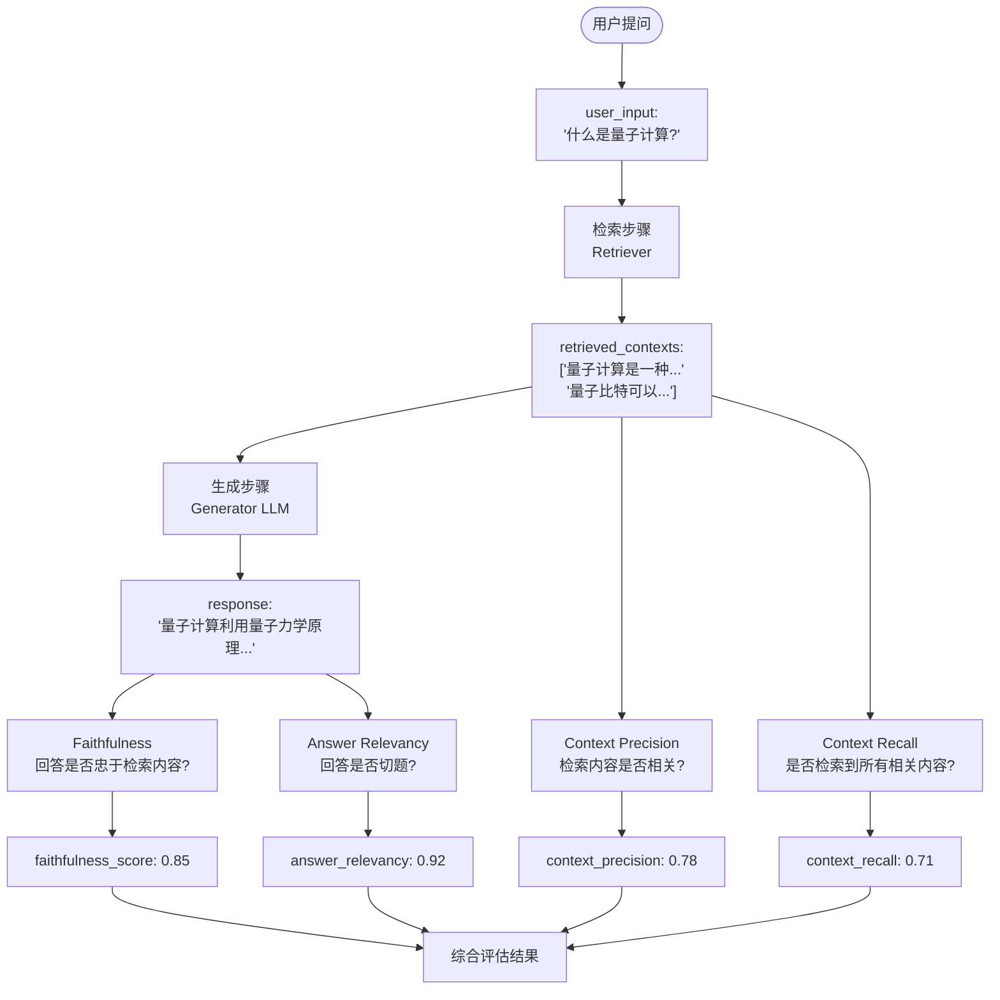

---

## 5. RAG 评估指标详解

### 5.1 Faithfulness（忠实度）

> **指标说明**：Faithfulness 衡量生成的回答是否忠实于检索到的上下文，即回答中的信息是否都能从上下文中推导出来，用于检测幻觉（hallucination）。

**计算公式**：
```
Faithfulness = 忠实陈述数 / 总陈述数
```

**评估流程**：

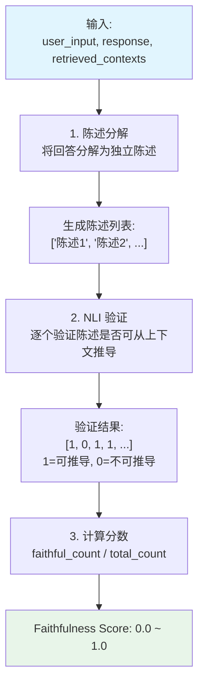

**示例**：

```
user_input: "量子计算有什么优势?"

retrieved_contexts:
  "量子计算利用量子比特(qubit)进行计算。与传统比特不同，
   量子比特可以处于叠加态，这使得量子计算机在某些特定问题上
   具有指数级的加速能力。"

response:
  "量子计算使用量子比特进行计算，可以在特定问题上实现指数级加速。
   量子计算机已经可以破解所有现有的加密系统。"

分解的陈述:
1. "量子计算使用量子比特进行计算" → ✓ (可从上下文推导)
2. "可以在特定问题上实现指数级加速" → ✓ (可从上下文推导)
3. "量子计算机已经可以破解所有现有的加密系统" → ✗ (上下文未提及)

Faithfulness = 2/3 = 0.67
```

---

### 5.2 Answer Relevancy（答案相关性）

> **指标说明**：Answer Relevancy 衡量生成的回答与用户问题的相关程度，回答中的不完整、冗余或不相关信息会被扣分。

**计算原理**：

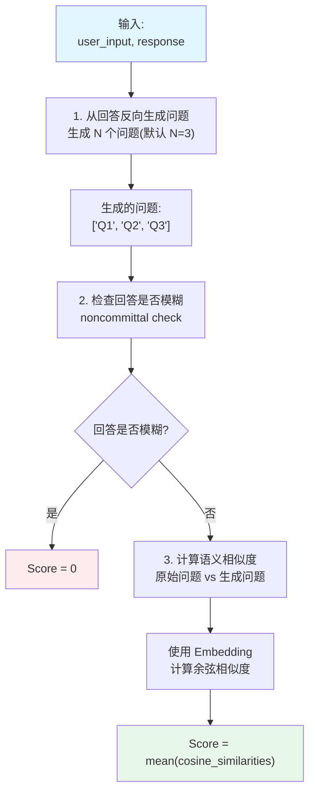

**示例**：

```
user_input: "什么是机器学习?"

response (好): "机器学习是人工智能的一个分支，它使计算机能够从数据中
              学习并改进性能，而无需显式编程。"

→ 生成的问题: ["机器学习是什么?", "什么是AI的一个分支?", ...]
→ 相似度: [0.95, 0.72, ...]
→ Answer Relevancy: 0.89

response (差): "我不太确定，但这可能和计算机有关..."

→ noncommittal = 1
→ Answer Relevancy: 0.0
```

---

### 5.3 Context Precision（上下文精度）

> **指标说明**：Context Precision 衡量检索到的上下文中，有多少是真正有用的。它使用 Average Precision 来计算，强调排名靠前的上下文应该是相关的。

**计算公式**：

```
Context Precision = Σ(Precision@k × relevance[k]) / 相关上下文总数
```

**评估流程**：

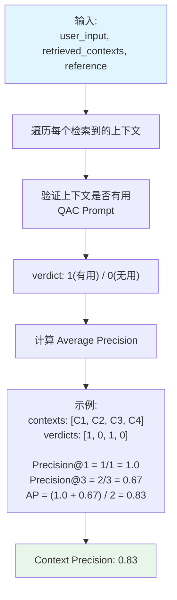

**示例**：

```
user_input: "谁赢得了2020年ICC世界杯?"

retrieved_contexts:
  C1: "2022 ICC T20世界杯在澳大利亚举行...英格兰获胜" → 1 (有用)
  C2: "板球是一项流行的运动..." → 0 (无用)
  C3: "英格兰队在2019年赢得了ODI世界杯" → 1 (部分有用)

verdicts: [1, 0, 1]
Precision@1 = 1/1 = 1.0
Precision@3 = 2/3 = 0.67
Context Precision = (1.0 + 0.67) / 2 = 0.835
```

---

### 5.4 Context Recall（上下文召回）

> **指标说明**：Context Recall 衡量检索系统是否检索到了所有必要的信息。它通过检查参考答案中的语句是否能从检索到的上下文中推导出来来评估。

**计算公式**：

```
Context Recall = 可从上下文推导的参考答案语句数 / 参考答案总语句数
```

**评估流程**：

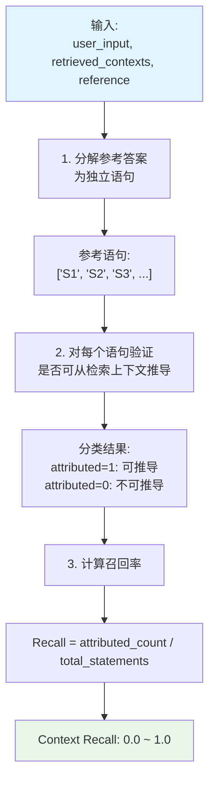

**示例**：

```
user_input: "爱因斯坦的生平?"

reference:
  "爱因斯坦1879年3月14日出生于德国。他是理论物理学家，
   因相对论而闻名。他于1921年获得诺贝尔物理学奖。
   他在1905年发表了4篇论文。"

retrieved_contexts:
  "爱因斯坦(1879-1955)是德国理论物理学家...
   因相对论闻名...1921年获得诺贝尔奖..."

分解的参考语句:
1. "爱因斯坦1879年3月14日出生" → attributed=1 ✓
2. "他是理论物理学家" → attributed=1 ✓
3. "因相对论闻名" → attributed=1 ✓
4. "1921年获得诺贝尔奖" → attributed=1 ✓
5. "1905年发表4篇论文" → attributed=0 ✗ (上下文未提及)

Context Recall = 4/5 = 0.8
```

---

### 5.5 Answer Correctness（答案正确性）

> **指标说明**：Answer Correctness 通过比较生成的回答与参考答案，评估回答的事实正确性。它结合了事实性(F1)和语义相似度两个维度。

**计算公式**：

```
Answer Correctness = w1 × F1_score + w2 × Semantic_similarity
默认权重: w1=0.75, w2=0.25
```

**评估流程**：

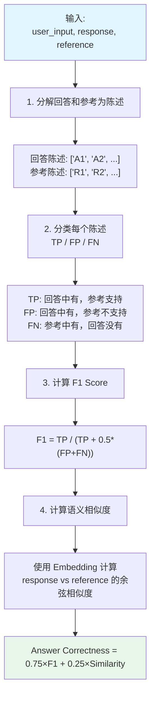

**示例**：

```
user_input: "太阳的动力来源是什么?"

response: "太阳通过核裂变产生能量，类似于地球上的核反应堆。"

reference: "太阳通过核聚变产生能量，氢原子聚合成氦。这个过程释放巨大能量。"

回答陈述: ["太阳通过核裂变产生能量"]
参考陈述: ["太阳通过核聚变产生能量", "氢原子聚合成氦", "这个过程释放巨大能量"]

分类:
- "太阳通过核裂变产生能量" → FP (错误! 应该是核聚变)
- "太阳通过核聚变产生能量" → FN (回答中缺失)
- "氢原子聚合成氦" → FN
- "这个过程释放巨大能量" → FN

TP=0, FP=1, FN=3
F1 = 0 / (0 + 0.5×4) = 0

Answer Correctness ≈ 0 (事实完全错误)
```

---

### 5.6 Factual Correctness（事实正确性）

> **指标说明**：Factual Correctness 使用 claim 分解和 NLI 验证来评估回答的事实正确性。支持 precision、recall 和 F1 三种模式。

**评估流程**：

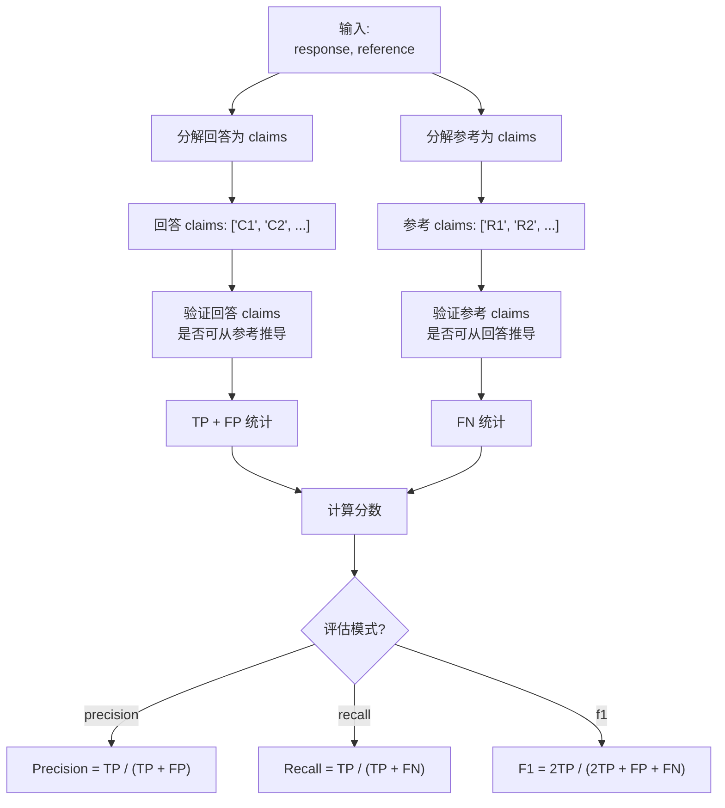

---

### 5.7 Context Entities Recall（上下文实体召回）

> **指标说明**：Context Entities Recall 衡量检索到的上下文中包含的命名实体占参考上下文中实体的比例。

**计算公式**：

```
Context Entities Recall = |检索上下文中的实体 ∩ 参考上下文中的实体| / |参考上下文中的实体|
```

**示例**：

```
reference_contexts:
  "苹果公司由史蒂夫·乔布斯于1976年在加利福尼亚州库比蒂诺创立。
   2023年市值达到3万亿美元。"

retrieved_contexts:
  "苹果公司是一家科技公司，总部设在加利福尼亚州。"

参考实体: {苹果公司, 史蒂夫·乔布斯, 1976, 库比蒂诺, 加利福尼亚州, 3万亿美元, 2023}
检索实体: {苹果公司, 加利福尼亚州}

Context Entities Recall = 2/7 = 0.29
```

---

### 5.8 Noise Sensitivity（噪声敏感度）

> **指标说明**：Noise Sensitivity 衡量系统对无关信息的敏感程度。它检测回答中有多少错误信息来自于无关的检索内容。

**评估模式**：
- `relevant`: 衡量来自相关上下文的错误
- `irrelevant`: 衡量来自无关上下文的错误

---

## 6. Agent 评估

### 6.1 Agent 评估原理

> **Agent 原理说明**：AI Agent 通过与用户和工具的多轮交互来完成任务。评估需要考察工具调用的准确性、目标达成度和主题遵循度。

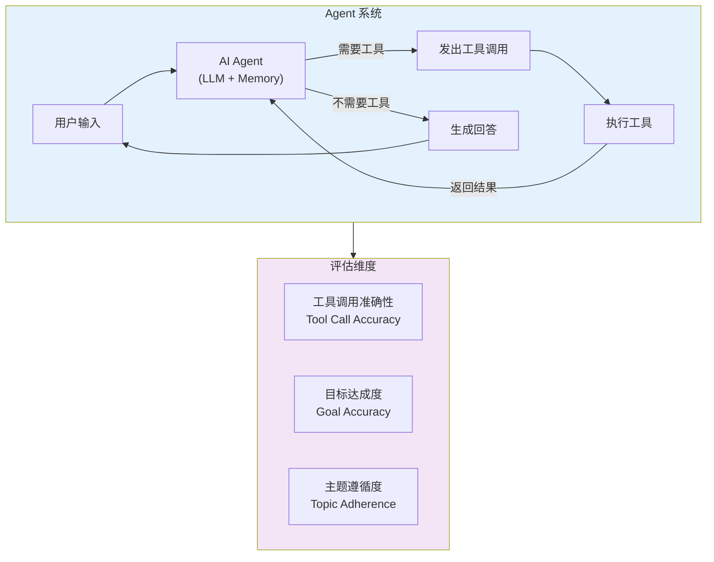

### 6.2 Agent 评估流程

> **评估流程说明**：Agent 评估收集完整的交互轨迹（Human → AI → Tool → AI → ...），然后从多个维度评估 Agent 的表现。

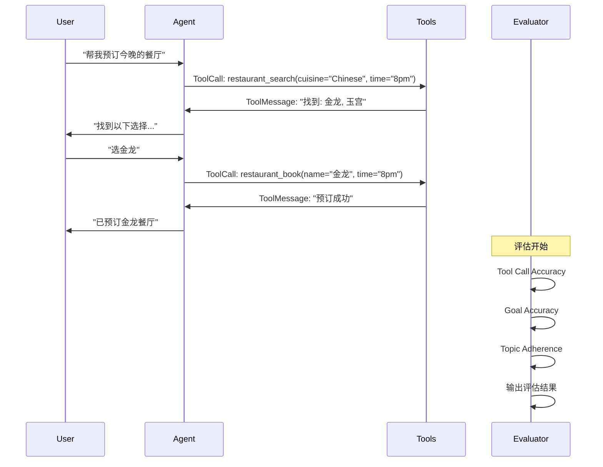

---

## 7. Agent 评估指标详解

### 7.1 Tool Call Accuracy（工具调用准确度）

> **指标说明**：Tool Call Accuracy 衡量 Agent 的工具调用与参考工具调用的匹配程度。评估包括序列对齐和参数准确性两个方面。

**计算公式**：

```
如果序列不对齐: Score = 0
如果序列对齐: Score = 平均参数准确率 × 序列对齐因子
```

**评估流程**：

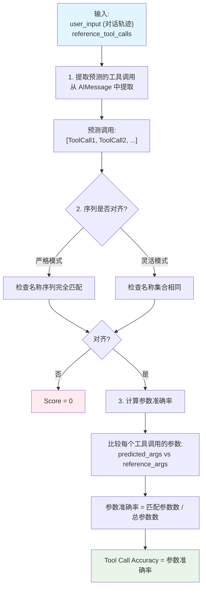

**示例**：

```
参考工具调用:
  reference_tool_calls = [
    ToolCall(name="restaurant_search", args={"cuisine": "Chinese", "time": "8pm"}),
    ToolCall(name="restaurant_book", args={"name": "金龙", "time": "8pm"})
  ]

Agent 实际调用:
  预测调用 = [
    ToolCall(name="restaurant_search", args={"cuisine": "Chinese", "time": "8pm"}),
    ToolCall(name="restaurant_book", args={"name": "金龙", "time": "8pm"})
  ]

序列对齐: ✓ (名称序列相同)
参数匹配:
  - restaurant_search: cuisine ✓, time ✓ → 2/2
  - restaurant_book: name ✓, time ✓ → 2/2

Tool Call Accuracy = (1.0 + 1.0) / 2 = 1.0

---

另一个例子 (参数不完全匹配):
  预测调用 = [
    ToolCall(name="restaurant_search", args={"cuisine": "Chinese"}),  # 缺少 time
    ToolCall(name="restaurant_book", args={"name": "金龙", "time": "8pm"})
  ]

序列对齐: ✓
参数匹配:
  - restaurant_search: cuisine ✓ → 1/2 = 0.5
  - restaurant_book: name ✓, time ✓ → 2/2 = 1.0

Tool Call Accuracy = (0.5 + 1.0) / 2 = 0.75
```

---

### 7.2 Agent Goal Accuracy（目标达成度）

> **指标说明**：Agent Goal Accuracy 评估 Agent 是否成功完成了用户的任务目标。使用 LLM 推断用户目标和最终状态，然后比较实际结果与期望结果。

**评估流程**：

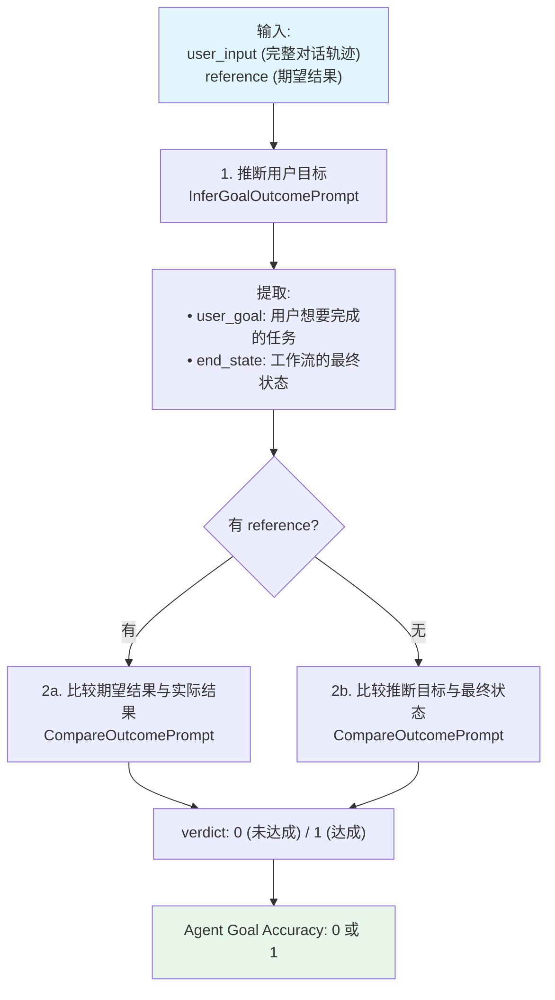

**示例**：

```
对话轨迹:
  Human: "帮我预订今晚8点最近最好的中餐厅"
  AI: "找到以下选择: 金龙, 玉宫"
  Human: "选金龙"
  AI: "已预订金龙餐厅晚上8点"
  Human: "谢谢"

LLM 推断:
  user_goal: "预订最近最好的中餐厅，晚上8点"
  end_state: "成功预订金龙餐厅(中餐厅)晚上8点"

reference: "成功预订任何中餐厅晚上8点"

比较结果:
  期望: 成功预订中餐厅晚上8点
  实际: 成功预订金龙餐厅(中餐厅)晚上8点
  verdict: 1 ✓

Agent Goal Accuracy = 1
```

---

### 7.3 Topic Adherence Score（主题遵循度）

> **指标说明**：Topic Adherence Score 评估 Agent 在对话中是否遵循了预期的主题。支持 precision、recall 和 F1 三种模式。

**计算公式**：

```
Precision = 正确回答的主题数 / 实际回答的主题数
Recall = 正确回答的主题数 / 期望回答的主题数
F1 = 2 × Precision × Recall / (Precision + Recall)
```

**评估流程**：

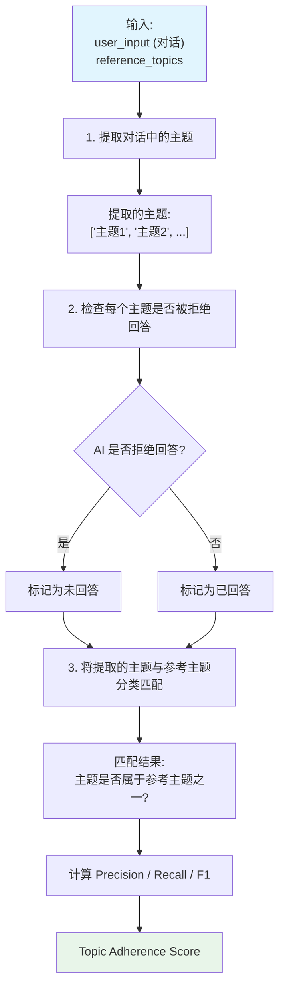

**示例**：

```
reference_topics: ["相对论", "量子力学"]

对话中提取的主题:
  - "爱因斯坦的相对论" → 匹配 "相对论" ✓
  - "广义相对论" → 匹配 "相对论" ✓
  - "薛定谔方程" → 不匹配 ✗

假设所有主题都被回答(未拒绝):
  TP = 2 (相对论相关的主题被正确回答)
  FP = 1 (薛定谔方程不是期望主题)
  FN = 0

Precision = 2 / (2 + 1) = 0.67
Recall = 2 / (2 + 0) = 1.0
F1 = 2 × 0.67 × 1.0 / (0.67 + 1.0) = 0.8
```

---

## 8. Workflow 评估

### 8.1 Workflow 评估原理

> **Workflow 原理说明**：Workflow 评估针对复杂的多步骤工作流，评估整个流程的执行效果。它与 Agent 评估类似，但更关注端到端的结果。

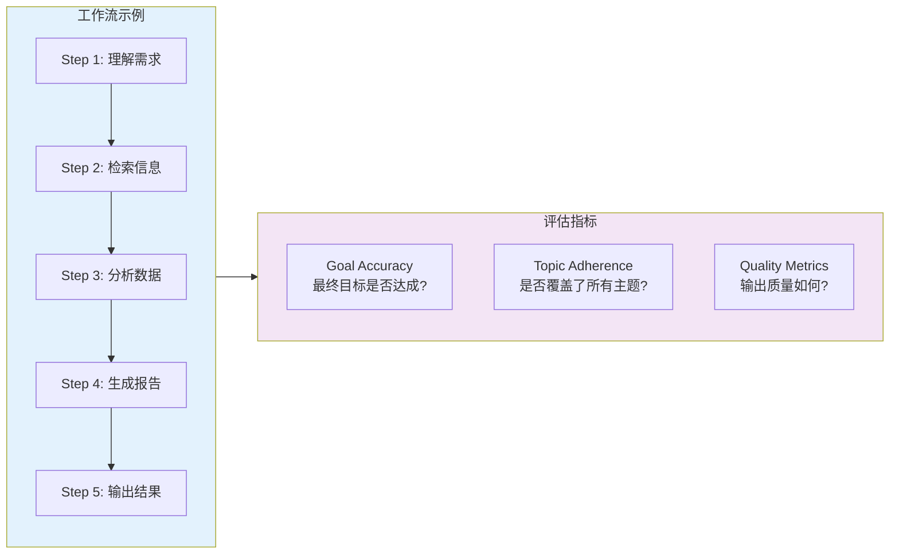

### 8.2 Workflow 评估适用指标

> **指标选择说明**：Workflow 评估可以组合使用多种指标，根据工作流的特点选择合适的评估维度。

| 评估维度 | 推荐指标 | 说明 |
|----------|----------|------|
| 目标达成 | Agent Goal Accuracy | 工作流是否完成预期目标 |
| 主题覆盖 | Topic Adherence | 是否覆盖了所有预期主题 |
| 输出忠实度 | Faithfulness | 输出是否忠于输入数据 |
| 输出相关性 | Answer Relevancy | 输出是否与输入相关 |
| 事实正确性 | Factual Correctness | 输出内容是否事实正确 |

---

## 9. 其他重要指标

### 9.1 Aspect Critic（方面评判）

> **指标说明**：Aspect Critic 是一个灵活的指标，允许用户自定义评判标准，对输出的特定方面进行二元判断。

**预定义方面**：

| 方面 | 定义 |
|------|------|
| harmfulness | 是否会造成伤害? |
| maliciousness | 是否意图欺骗或剥削? |
| coherence | 是否逻辑连贯? |
| correctness | 是否事实正确? |
| conciseness | 是否简洁高效? |

**使用示例**：

```python
# 自定义方面评判
professionalism = AspectCritic(
    name="professionalism",
    definition="回答是否使用专业、正式的语言?"
)

toxicity = AspectCritic(
    name="toxicity",
    definition="回答是否包含有毒或冒犯性的内容?"
)
```

---

### 9.2 Summarization Score（摘要质量评分）

> **指标说明**：Summarization Score 评估文本摘要的质量，综合考虑信息保留和简洁性。

**评估流程**：

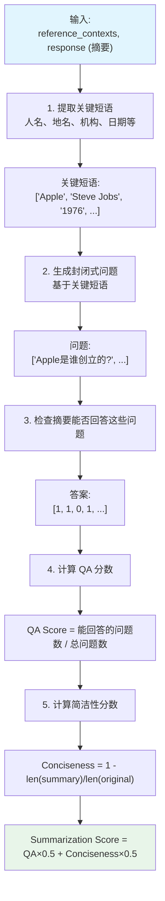

---

### 9.3 非 LLM 指标

> **指标说明**：Ragas 还提供了一系列不需要调用 LLM 的传统指标，计算速度更快，成本更低。

| 指标 | 说明 | 适用场景 |
|------|------|----------|
| ExactMatch | 精确字符串匹配 | 简单答案验证 |
| BleuScore | BLEU 评分 | 翻译质量评估 |
| RougeScore | ROUGE 评分 | 摘要质量评估 |
| ChrfScore | chrF 评分 | 字符级 F 值 |
| StringPresence | 字符串存在性检查 | 关键词检查 |
| NonLLMStringSimilarity | 字符串相似度 | 近似匹配 |

---

## 10. 指标选择指南

### 10.1 RAG 场景指标选择

> **选择指南说明**：根据 RAG 系统的不同评估需求，选择合适的指标组合。

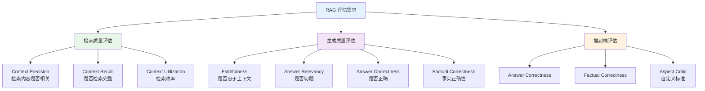

### 10.2 Agent 场景指标选择

> **Agent 指标选择说明**：Agent 评估需要综合考虑工具调用、目标达成和对话质量。

| 评估重点 | 推荐指标 | 需要的数据 |
|----------|----------|------------|
| 工具使用正确性 | Tool Call Accuracy | reference_tool_calls |
| 任务完成度 | Agent Goal Accuracy | reference (期望结果) |
| 主题遵循 | Topic Adherence | reference_topics |
| 回答质量 | Faithfulness | retrieved_contexts |
| 安全性 | AspectCritic | 自定义评判标准 |

### 10.3 指标依赖关系

> **依赖关系说明**：某些指标需要特定的输入字段，选择指标时需确保数据集包含所需字段。

```mermaid
graph LR
    subgraph Required["必需字段"]
        UI["user_input"]
        Res["response"]
        Ref["reference"]
        RC["retrieved_contexts"]
        RTC["reference_tool_calls"]
    end

    subgraph Metrics["指标"]
        F["Faithfulness"]
        AR["Answer Relevancy"]
        CP["Context Precision"]
        CR["Context Recall"]
        AC["Answer Correctness"]
        TCA["Tool Call Accuracy"]
    end

    UI --> F
    Res --> F
    RC --> F

    UI --> AR
    Res --> AR

    UI --> CP
    RC --> CP
    Ref --> CP

    UI --> CR
    RC --> CR
    Ref --> CR

    UI --> AC
    Res --> AC
    Ref --> AC

    UI --> TCA
    RTC --> TCA

    style Required fill:#e8f5e9
    style Metrics fill:#e3f2fd
```

---

## 11. 关键组件索引

### 11.1 核心文件

| 组件 | 路径 | 描述 |
|------|------|------|
| Dataset Schema | `src/ragas/dataset_schema.py` | 定义 SingleTurnSample, MultiTurnSample |
| Evaluation | `src/ragas/evaluation.py` | evaluate() 函数实现 |
| Messages | `src/ragas/messages.py` | HumanMessage, AIMessage, ToolCall |

### 11.2 RAG 指标

| 指标 | 路径 | 描述 |
|------|------|------|
| Faithfulness | `src/ragas/metrics/_faithfulness.py` | 忠实度评估 |
| Answer Relevancy | `src/ragas/metrics/_answer_relevance.py` | 答案相关性 |
| Context Precision | `src/ragas/metrics/_context_precision.py` | 上下文精度 |
| Context Recall | `src/ragas/metrics/_context_recall.py` | 上下文召回 |
| Answer Correctness | `src/ragas/metrics/_answer_correctness.py` | 答案正确性 |
| Factual Correctness | `src/ragas/metrics/_factual_correctness.py` | 事实正确性 |

### 11.3 Agent 指标

| 指标 | 路径 | 描述 |
|------|------|------|
| Tool Call Accuracy | `src/ragas/metrics/_tool_call_accuracy.py` | 工具调用准确度 |
| Agent Goal Accuracy | `src/ragas/metrics/_goal_accuracy.py` | 目标达成度 |
| Topic Adherence | `src/ragas/metrics/_topic_adherence.py` | 主题遵循度 |

### 11.4 通用指标

| 指标 | 路径 | 描述 |
|------|------|------|
| Aspect Critic | `src/ragas/metrics/_aspect_critic.py` | 自定义方面评判 |
| Summarization | `src/ragas/metrics/_summarization.py` | 摘要质量 |
| Noise Sensitivity | `src/ragas/metrics/_noise_sensitivity.py` | 噪声敏感度 |

---

## 12. 使用示例

### 12.1 RAG 评估示例

```python
from ragas.dataset_schema import SingleTurnSample
from ragas.metrics.collections import Faithfulness, AnswerRelevancy

# 准备数据
sample = SingleTurnSample(
    user_input="量子计算有什么优势?",
    retrieved_contexts=[
        "量子计算利用量子比特进行计算...",
        "与传统计算相比，量子计算在某些问题上具有指数级加速能力..."
    ],
    response="量子计算可以在特定问题上实现指数级加速...",
    reference="量子计算具有指数级加速优势..."
)

# 评估
faithfulness = Faithfulness()
relevancy = AnswerRelevancy()

faith_score = await faithfulness.ascore(sample)
relevancy_score = await relevancy.ascore(sample)
```

### 12.2 Agent 评估示例

```python
from ragas.dataset_schema import MultiTurnSample
from ragas.messages import HumanMessage, AIMessage, ToolMessage, ToolCall
from ragas.metrics.collections import ToolCallAccuracy, AgentGoalAccuracyWithReference

# 准备对话数据
sample = MultiTurnSample(
    user_input=[
        HumanMessage(content="帮我预订中餐厅"),
        AIMessage(content="", tool_calls=[
            ToolCall(name="restaurant_search", args={"cuisine": "Chinese"})
        ]),
        ToolMessage(content="找到: 金龙, 玉宫"),
        AIMessage(content="找到以下选择..."),
        HumanMessage(content="选金龙"),
        AIMessage(content="", tool_calls=[
            ToolCall(name="restaurant_book", args={"name": "金龙"})
        ]),
        ToolMessage(content="预订成功"),
        AIMessage(content="已预订金龙餐厅")
    ],
    reference_tool_calls=[
        ToolCall(name="restaurant_search", args={"cuisine": "Chinese"}),
        ToolCall(name="restaurant_book", args={"name": "金龙"})
    ],
    reference="成功预订金龙餐厅"
)

# 评估
tool_acc = ToolCallAccuracy()
goal_acc = AgentGoalAccuracyWithReference()

tool_score = await tool_acc.ascore(sample)
goal_score = await goal_acc.ascore(sample)
```

---

## 附录：完整指标速查表

| 指标名称 | 类型 | 必需字段 | 输出范围 | 说明 |
|----------|------|----------|----------|------|
| Faithfulness | RAG | user_input, response, retrieved_contexts | [0, 1] | 回答是否忠于上下文 |
| Answer Relevancy | RAG | user_input, response | [0, 1] | 回答是否切题 |
| Context Precision | RAG | user_input, retrieved_contexts, reference | [0, 1] | 检索精度 |
| Context Recall | RAG | user_input, retrieved_contexts, reference | [0, 1] | 检索召回 |
| Context Utilization | RAG | user_input, response, retrieved_contexts | [0, 1] | 上下文利用率 |
| Answer Correctness | RAG | user_input, response, reference | [0, 1] | 答案正确性 |
| Factual Correctness | RAG | response, reference | [0, 1] | 事实正确性 |
| Context Entity Recall | RAG | retrieved_contexts, reference_contexts | [0, 1] | 实体召回 |
| Noise Sensitivity | RAG | user_input, response, reference, retrieved_contexts | [0, 1] | 噪声敏感度 |
| Summarization Score | RAG | reference_contexts, response | [0, 1] | 摘要质量 |
| Tool Call Accuracy | Agent | user_input, reference_tool_calls | [0, 1] | 工具调用准确度 |
| Agent Goal Accuracy | Agent | user_input, reference | {0, 1} | 目标达成度 |
| Topic Adherence | Agent | user_input, reference_topics | [0, 1] | 主题遵循度 |
| Aspect Critic | General | 可配置 | {0, 1} | 自定义方面评判 |
| Bleu Score | NLP | response, reference | [0, 1] | 翻译质量 |
| Rouge Score | NLP | response, reference | [0, 1] | 摘要质量 |
| Exact Match | String | response, reference | {0, 1} | 精确匹配 |
